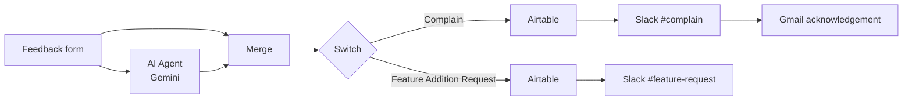

# AI Customer Feedback Triage (n8n + Gemini)

An n8n automation that reads customer feedback, uses an AI agent (Google Gemini) to classify it, and routes it automatically: complaints are logged, alerted to the team, and acknowledged by email, and feature requests are logged and shared with the team.

Support teams usually sort feedback by hand. This workflow does that triage the moment a form is submitted.

## What it does

The AI agent labels every submission as one of: `Complain`, `Compliment`, or `Feature Addition Request`.

| Category | Logged in Airtable | Slack alert | Email to customer |
|---|---|---|---|
| **Complain** | Yes | `#complain` (name, email, feedback) | Acknowledgement that the complaint is being handled |
| **Feature Addition Request** | Yes | `#feature-request` | No |

## How it works

1. **Form trigger:** the customer submits their full name, email, contact number, and feedback through an n8n form.
2. **AI Agent:** an n8n AI Agent backed by Google Gemini reads the feedback and replies with one label: `Complain`, `Compliment`, or `Feature Addition Request`.
3. **Merge:** joins the original form data with the AI label into one record.
4. **Switch:** sends the record down the branch that matches the label.
5. **Actions:** complaints are saved to Airtable, posted to Slack, and acknowledged by Gmail; feature requests are saved to Airtable and posted to Slack.

## Tech stack

- **n8n** for workflow orchestration (Form Trigger, AI Agent, Merge, Switch)
- **Google Gemini** as the language model behind the AI Agent
- **Airtable** as the feedback database
- **Slack** for team alerts
- **Gmail** for automatic customer replies

## Run it yourself

1. **Import:** in n8n, create a new workflow, open the `...` menu, choose **Import from File**, and select `workflows/ai-customer-feedback-triage.json`.
2. **Add credentials** when each node asks: Google Gemini API key, Airtable personal access token, Slack (OAuth2), and Gmail (OAuth2).
3. **Airtable:** create a table with the text fields `Full Name`, `Email`, `Contact Info`, and `Feedback`, then select your base and table in the two Airtable nodes (they contain `YOUR_AIRTABLE_BASE_ID` / `YOUR_AIRTABLE_TABLE_ID` placeholders).
4. **Slack:** create the channels `#complain` and `#feature-request` and invite your Slack app to both.
5. **Test:** click **Execute workflow**, open the form, and submit a complaint and a feature request.

## Author

**Pranav Sharma**, B.Tech Computer Science, Thapar Institute of Engineering and Technology
[LinkedIn](https://www.linkedin.com/in/pranav-sharma025) | [GitHub](https://github.com/Pranavsh025)
